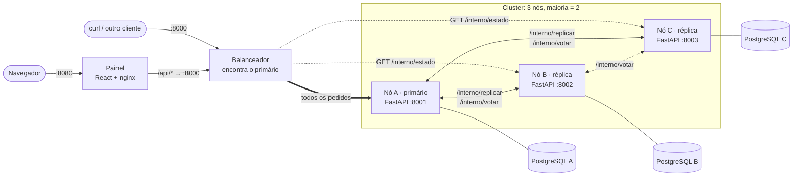
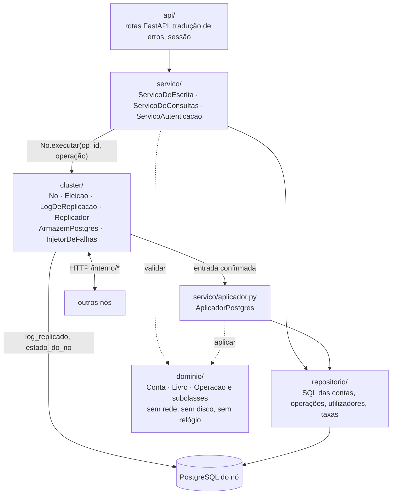
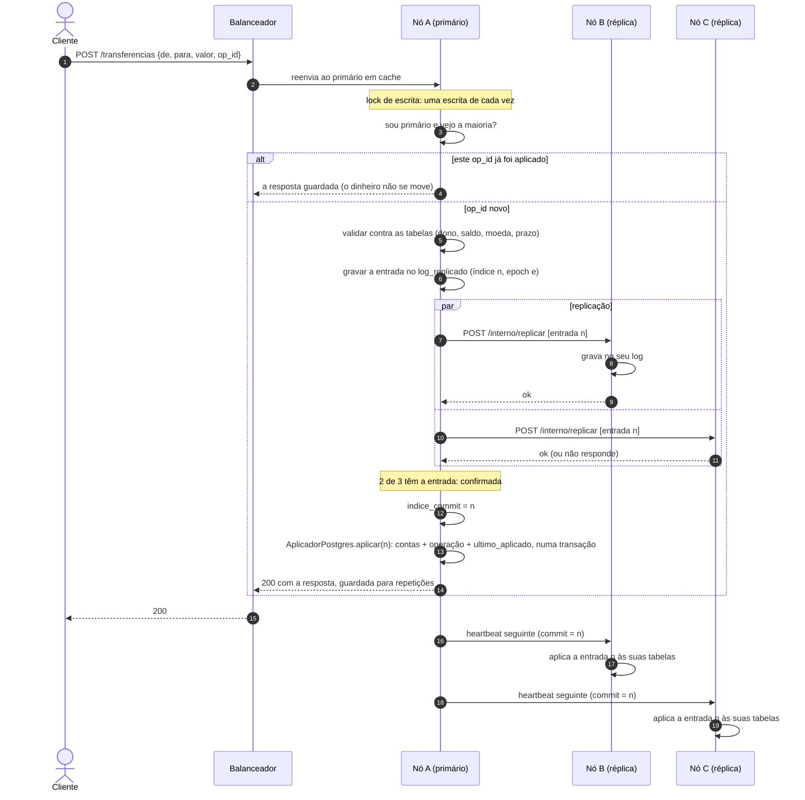
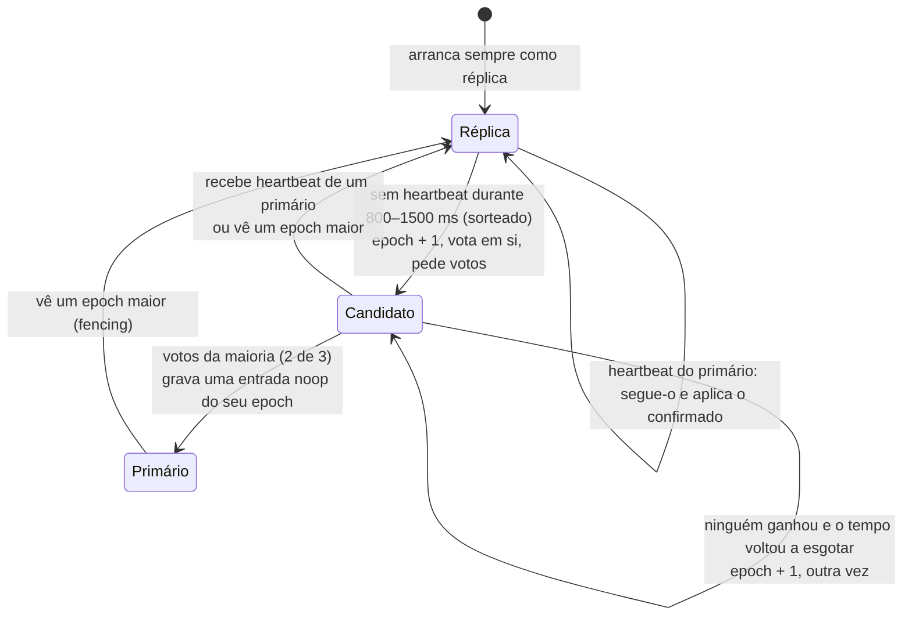
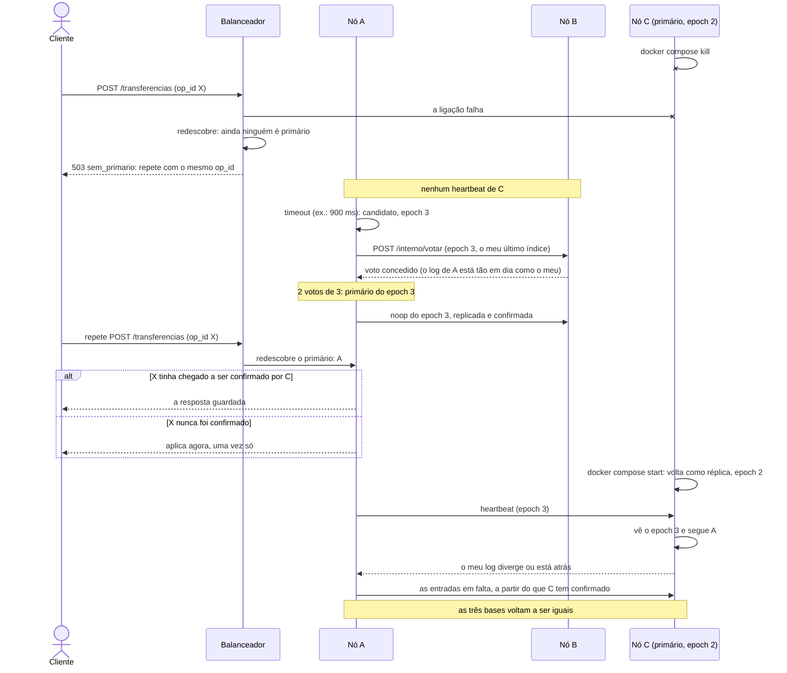
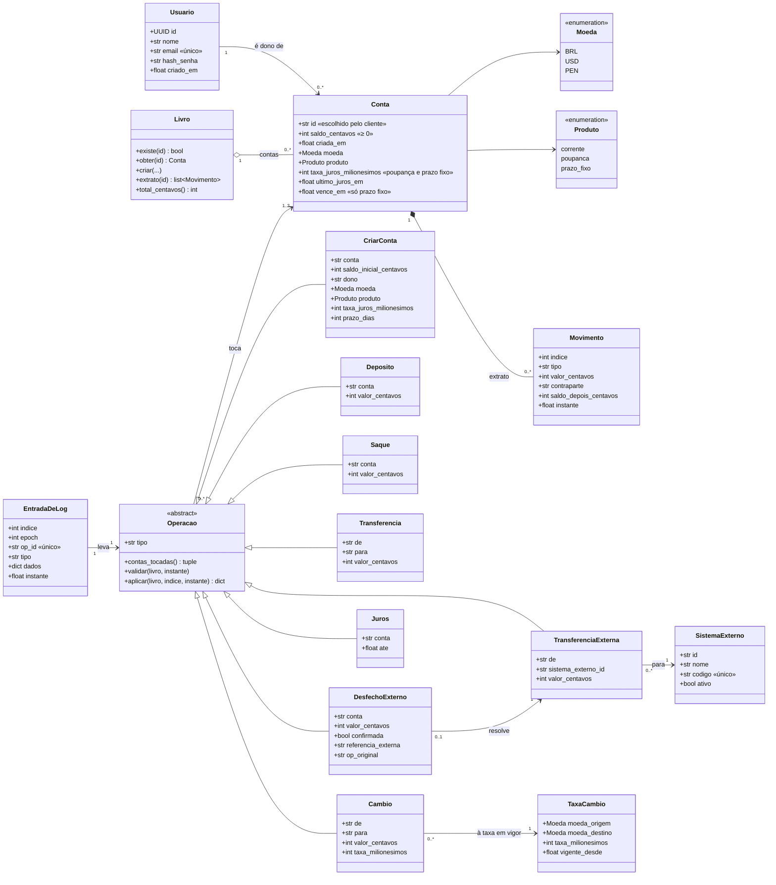
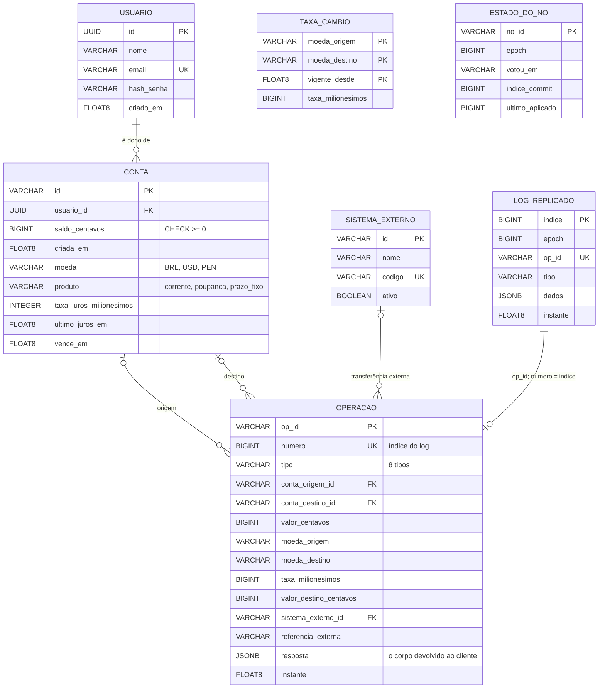

# Relatório — Protótipo 2 do Banco Distribuído

**Um banco replicado em três nós que sobrevive à queda do primário sem perder
nem duplicar dinheiro**

Trabalho da disciplina de Computação Distribuída
Universidade de São Paulo — Instituto de Ciências Matemáticas e de Computação
Campus São Carlos

| Número USP | Nome |
|---|---|
| 18404636 | Jefferson Daniel Flores Montenegro |
| 18514632 | Cristhian Jesus Maylle Briceño |
| 17819748 | Paulo Sebastian Rojo Pinedo |

---

## Resumo

O Protótipo 2 transforma o banco de um nó só do Protótipo 1 num sistema de três
nós, cada um com a sua própria base PostgreSQL. Os nós elegem um primário por
voto, com um número de mandato (`epoch`), e todas as escritas — operações de
dinheiro, mas também registo de utilizadores e de taxas de câmbio — passam por
um log replicado: uma escrita só é confirmada ao cliente depois de estar gravada
no log da maioria dos nós (2 de 3). As tabelas de cada nó são a materialização
desse log confirmado, aplicado pela mesma função em todos os nós.

Matámos o primário a meio de transferências concorrentes. Outro nó foi eleito 
**1,23 s** depois (o requisito RNF-03 pede
menos de 2 s), nenhuma operação confirmada se perdeu, nenhuma foi aplicada duas
vezes, e o total de dinheiro não mudou. Quando o nó morto voltou, entrou como
réplica, recuperou o que tinha perdido, e as três bases ficaram com a mesma
impressão digital (contagens e `md5` das tabelas). O backend tem **251 testes**
que passam contra um PostgreSQL real, sete deles com três processos, três bases
e `kill -9` do primário.

O que ainda falta: autenticar as rotas internas do protocolo, medir o débito
(RNF-04/05) e explicar uma falha intermitente, vista uma vez em 35 execuções do
teste do cluster.

---

## 1. Introdução e objetivos

### 1.1 Contexto

O projeto tem três etapas:

| Etapa | Objetivo | Estado |
|---|---|---|
| Protótipo 1 | Um banco correto num nó: atomicidade, idempotência, invariante do dinheiro | entregue, 111 testes |
| **Protótipo 2** | **Sobreviver à queda de um servidor** | **este relatório** |
| Etapa final | Implantar na AWS, medir e demonstrar | próxima |

No Protótipo 1 o PostgreSQL era um ponto único de falha: se a base ou o nó
caíssem, o banco parava. O caminho de uma escrita tinha um passo vazio,
"replicar e esperar pela maioria", reservado para esta etapa.

### 1.2 Objetivos desta etapa

1. **Disponibilidade:** com três nós, a queda de um qualquer, incluindo o
   primário, não pode parar o banco por mais de 2 s (RNF-03).
2. **Durabilidade:** nada do que foi confirmado ao cliente se pode perder
   (RNF-02), nem com o primário a morrer a meio de uma operação.
3. **Correção:** o invariante do dinheiro tem de se manter — o dinheiro não é
   criado nem destruído (RNF-01) — e uma operação repetida depois de um
   failover não pode ser aplicada duas vezes (RF-13).
4. **Consistência entre réplicas:** as três bases têm de ficar iguais, incluindo
   o nó que esteve em baixo (RF-12).
5. **Requisitos de negócio novos:** moedas, câmbio, produtos (poupança e prazo
   fixo), juros e transferência para outro banco (RF-19 a RF-25), e sessão com
   dono da conta.

---

## 2. Requisitos e cobertura

| Requisito | Descrição | Estado | Evidência |
|---|---|---|---|
| RF-01 a RF-08, RF-14 | Contas, depósito, saque, transferência, extrato, auditoria | cobertos | testes de integração; sessão da API, secções 3–5 e 11 |
| RF-09 | Eleição de um primário | coberto | `teste_eleicao.py`, `teste_no.py`, `teste_cluster.py` |
| RF-10 | Escrita confirmada só depois da maioria | coberto | `teste_cluster.py`: cada escrita nas três bases |
| RF-11 | Continuar com a queda de um nó | coberto | sessão da API, secção 12 |
| RF-12 | Reintegração do nó que caiu | coberto | impressão digital igual nas três bases depois do regresso |
| RF-13 | Repetir com o mesmo `op_id` não duplica | coberto | `teste_idempotencia.py`; repetição depois do failover |
| RF-15 | Métricas | **por fazer** | — |
| RF-16 | Injeção de falhas | coberto | `POST /admin/falha`; `TesteParticao` |
| RF-17 | Cliente de linha de comando | **por fazer** | — |
| RF-19 a RF-25 | Moedas, câmbio, produtos, juros, outro banco | cobertos | `teste_produtos.py`; sessão da API, secções 7–9 |
| RNF-01 | O dinheiro não é criado nem destruído | coberto | `teste_invariante.py`; auditoria depois da queda |
| RNF-02 | Nada confirmado se perde | coberto | `teste_cluster.py`; secção 12 da sessão |
| RNF-03 | Failover em menos de 2 s | coberto | **1,23 s** medido |
| RNF-04, RNF-05 | Débito de escritas e leituras | **por medir** | — |

---

## 3. Arquitetura

### 3.1 Componentes

| Componente | Tecnologia | Papel |
|---|---|---|
| Nó (×3) | Python 3.12, FastAPI, uvicorn, psycopg2 | API do banco e protocolo de replicação |
| Base (×3) | PostgreSQL 16 | Log replicado, estado do nó e tabelas do banco; cada nó só fala com a sua |
| Balanceador | FastAPI (ou AWS Lambda) | Descobre o primário e reencaminha-lhe todos os pedidos |
| Painel | React + Vite, servido por nginx | Contas, transferências, auditoria e o estado do cluster ao vivo |

A forma como se ligam está no [diagrama 4.1](#41-as-peças-e-por-onde-passa-um-pedido).

### 3.2 Por que é que todos os nós guardam todas as contas

Optámos por **replicação total** em vez de particionar as contas entre nós.
Com todas as contas em todos os nós, uma transferência é sempre local ao
primário: débito e crédito vão na mesma entrada do log e aplicam-se na mesma
transação. Assim não é preciso *commit* em duas fases nem coordenação entre
partições, e a atomicidade de uma transferência vem diretamente da transação
do PostgreSQL. O custo é que todas as escritas passam por um só primário, o que
limita o débito (ver [secção 8](#8-discussão-e-limitações)).

### 3.3 Camadas de um nó

As camadas estão no [diagrama 4.2](#42-as-camadas-de-um-nó). O domínio não
depende de nada: `python3 -c "import banco.dominio.operacoes"` não carrega
psycopg2 nem FastAPI, e é por isso que 165 testes (domínio e o protocolo com
três nós em memória) correm só com o Python.

---

## 4. Estrutura e funcionamento, em diagramas

### 4.1 As peças e por onde passa um pedido

O cliente nunca escolhe um nó: fala com o balanceador, que pergunta aos três
quem é o primário e lhe manda tudo. Cada nó só fala com a **sua** base; as bases
não se conhecem. O que as mantém iguais é o protocolo entre os nós. O papel de
primário é de quem ganhar a eleição, aqui A, mas pode ser qualquer um.

### 4.2 As camadas de um nó

As setas apontam para dentro, e o domínio não aponta para lado nenhum. A escrita
entra pelo serviço, passa pelo `No` (que a replica) e só chega às tabelas pelo
`AplicadorPostgres`, que é o mesmo código no primário e nas réplicas.

### 4.3 O caminho de uma escrita

Uma transferência, do pedido à resposta.

Se o primário já não o for, responde `409 nao_sou_primario` com o endereço do
provável primário; se a ligação falhar, o balanceador volta a perguntar quem é o
primário. Nos dois casos repete **uma vez**, com o mesmo `op_id`, e é por isso
que repetir é seguro. Se a maioria não responder dentro do prazo de replicação,
a resposta é `503 sem_quorum` e a entrada fica por confirmar até a maioria
voltar.

### 4.4 Os papéis de um nó

Um nó só vota uma vez por `epoch`, e só num candidato com o log pelo menos tão
atualizado como o seu. Por isso o vencedor tem sempre tudo o que foi confirmado.

### 4.5 O failover

O primário C morre a meio do trabalho.

Na prova guardada em [`provas/`](provas/README.md) este intervalo — da morte do
primário à eleição do novo — durou 1,23 s.

### 4.6 O banco, em UML

O cliente do banco é o `Usuario`: não há uma entidade "pessoa" à parte. As
classes são as do domínio (`banco/dominio/`), mais as três que vivem à volta
dele: o utilizador, a taxa de câmbio e o outro banco.

Como ler as cardinalidades:

- Um utilizador tem **zero ou mais** contas; cada conta tem **exatamente um**
  dono, que vem do token e não do corpo do pedido.
- Uma operação toca **uma ou duas** contas: duas na transferência e no câmbio
  (origem e destino), uma em todas as outras. Uma conta é tocada por **zero ou
  mais** operações, e cada uma deixa um `Movimento` no seu extrato.
- O câmbio leva dentro de si a taxa que estava **em vigor** quando foi feito, e
  por isso repeti-lo depois de a taxa mudar dá o mesmo resultado.
- Uma transferência externa tem **no máximo um** desfecho: confirmada, ou
  devolvida à conta de origem.
- Cada entrada do log leva **uma** operação. As operações de dinheiro são estas
  oito; o log leva também três que não movem dinheiro (`RegistarUsuario`,
  `RegistarTaxa` e `Noop`, em `cluster/operacoes_de_sistema.py`).

### 4.7 As tabelas de cada nó

Cada nó tem uma cópia destas sete tabelas na sua própria base.

- `log_replicado` é a fonte da verdade; `conta`, `operacao`, `usuario` e
  `taxa_cambio` são o log confirmado já aplicado. A ligação entre os dois é o
  `op_id` (o mesmo nas duas tabelas) e `operacao.numero`, que é o índice da
  entrada no log — igual nos três nós.
- Nem toda a entrada do log gera uma linha em `operacao`: registar um
  utilizador, registar uma taxa e a `noop` mudam outras tabelas ou nenhuma.
- `estado_do_no` tem uma linha só: o `epoch` deste nó, em quem votou, até onde o
  log está confirmado e até onde já foi aplicado às tabelas.
- `taxa_cambio` não tem chave estrangeira: o câmbio lê a taxa em vigor e
  copia-a para a sua própria linha de `operacao`.

---

## 5. O protocolo de replicação

O protocolo segue a estrutura do Raft (D. Ongaro e J. Ousterhout, *In Search of
an Understandable Consensus Algorithm*, USENIX ATC 2014): um líder por mandato,
um log replicado com confirmação por maioria, e votos restritos a candidatos com
log suficientemente atualizado. O `epoch` corresponde ao *term* do Raft. A
principal simplificação está na reconciliação de logs divergentes
([5.4](#54-recuperação-e-reintegração)).

### 5.1 Eleição

Os papéis e as transições estão no [diagrama 4.4](#44-os-papéis-de-um-nó), e
uma eleição depois de uma queda no [diagrama 4.5](#45-o-failover).

- Uma réplica que não recebe heartbeat durante um tempo **sorteado** entre 800 e
  1500 ms candidata-se com `epoch + 1` e vota em si própria. O sorteio evita que
  duas réplicas se candidatem sempre ao mesmo tempo e dividam os votos.
- Cada nó vota **uma vez por `epoch`**, e o voto fica gravado na base
  (`estado_do_no.votou_em`) antes da resposta. Um nó que reinicie não pode votar
  duas vezes no mesmo mandato.
- Um nó só vota num candidato cujo log esteja **pelo menos tão atualizado** como
  o seu. Como qualquer entrada confirmada está numa maioria, e qualquer eleição
  precisa de outra maioria, as duas cruzam-se em pelo menos um nó, e esse nó
  recusa candidatos sem essa entrada. Assim, **o vencedor tem sempre tudo o que
  foi confirmado**.
- Ao ganhar, o novo primário grava uma entrada `noop` do seu `epoch`. Com isso
  confirma, de forma indireta, as entradas de mandatos anteriores que tenham
  ficado por confirmar.

### 5.2 O caminho de uma escrita

A sequência completa está no [diagrama 4.3](#43-o-caminho-de-uma-escrita).

Todos os dados não deterministas — instante, ids gerados, o sal do hash da
senha — são decididos pelo primário e vão **dentro** da entrada. Assim, aplicar
a mesma entrada dá o mesmo resultado em qualquer nó. O registo de utilizadores
e de taxas de câmbio também passa pelo log; sem isso, depois de um failover um
utilizador não conseguiria entrar e um câmbio daria valores diferentes conforme
o nó.

### 5.3 Fencing e partições

Um primário antigo que volte, ou que fique do lado minoritário de uma partição,
tem um `epoch` menor que o atual. A primeira resposta de qualquer réplica com
`epoch` maior faz com que se despromova. Do lado minoritário não se confirma
nada, porque não há maioria, e por isso não é possível haver *split-brain* com
escritas confirmadas dos dois lados. O teste `TesteParticao`, em memória,
cobre este caso usando o injetor de falhas.

### 5.4 Recuperação e reintegração

- `estado_do_no.ultimo_aplicado` avança **na mesma transação** que aplica a
  entrada às tabelas. Um nó que caia a meio volta, aplica o que estiver
  confirmado e ainda por aplicar, e só depois responde.
- Uma réplica com log atrasado ou divergente diz ao primário o seu último
  índice, e o primário reenvia a partir daí. O Raft recua um índice de cada vez;
  nós usamos um atalho. Entradas divergentes são truncadas, **mas nunca abaixo
  do índice confirmado**.
- Não há *snapshots*: um nó que esteve muito tempo em baixo recebe o log em
  lotes, um lote por ronda de heartbeat.

### 5.5 Parâmetros

| Parâmetro | Valor | Efeito |
|---|---|---|
| Heartbeat | 150 ms | Frequência a que o primário prova que está vivo e propaga o commit |
| Timeout de eleição | 800–1500 ms, sorteado | Tempo até uma réplica desistir do primário |
| Prazo de replicação | 500 ms | Tempo máximo de espera pela maioria antes de `503 sem_quorum` |
| Nós / maioria | 3 / 2 | Tolera a queda de um nó |

O failover esperado fica entre o timeout de eleição mínimo e o máximo, mais
uma ronda de votos: cerca de 0,8 a 1,6 s. O valor medido, 1,23 s, está dentro
desse intervalo.

---

## 6. Correção do dinheiro

Do Protótipo 1 mantivemos quatro mecanismos, que aqui servem também para o
failover:

| Mecanismo | O que garante |
|---|---|
| **Dinheiro em centavos inteiros**, recebido como texto (`"25.00"`) e convertido uma vez, na fronteira; taxas em milionésimos inteiros | Nenhum erro de vírgula flutuante; a mesma entrada dá o mesmo valor em qualquer nó |
| **`op_id` escolhido pelo cliente**, único no log e em `operacao`, com a resposta guardada | Repetir um pedido, também depois de um failover, devolve a mesma resposta e não move o dinheiro outra vez |
| **Uma escrita de cada vez no primário**, da validação à aplicação, e `SELECT … FOR UPDATE` por ordem de id ao aplicar | Cada validação vê o estado deixado pela escrita anterior; não há *deadlocks* |
| **Auditoria dupla, por moeda**: soma dos saldos contra soma do histórico | Deteta qualquer criação ou destruição de dinheiro |

O câmbio leva dentro da entrada a taxa em vigor no momento da operação. Por
isso, repeti-lo depois de a taxa mudar dá o mesmo resultado (verificado na
secção 7 da sessão da API, com a taxa a mudar de 5,43 para 6,00).

---

## 7. Avaliação experimental

### 7.1 Ambiente

Debian 13; Python 3.13.5 nos testes e 3.12 nas imagens; Node 20.19.2;
Docker 29.8 com Compose 5.6; `postgres:16-alpine`. Os três nós e as três bases
correm na mesma máquina, em contentores.

### 7.2 Testes automáticos

| Suite | Resultado |
|---|---|
| Sem dependências (só Python) | **165 passam**; 86 saltam-se com o motivo escrito |
| Backend com PostgreSQL 16 | **251 passam** |
| Balanceador | **5 passam** |
| Painel (`npm run build`) | compila |

Os sete testes de `tests/integracao/teste_cluster.py` arrancam três processos
reais com três bases e matam o primário com `kill -9`. Verificam que há um só
primário, que cada escrita chega às três bases, que o failover acontece com
`epoch` maior dentro do orçamento, que nada confirmado se perde, que repetir o
`op_id` não duplica, que o nó morto volta e recupera, que sem maioria não se
escreve, e que o total não muda com o primário a morrer a meio de
transferências.

### 7.3 Experiência central: queda do primário a meio de transferências

Procedimento (secção 12 de [`provas/api/sessao.md`](provas/api/sessao.md)):

1. Verificar que as três bases têm a mesma impressão digital.
2. Pôr três clientes a transferir 0,01 sem parar; cada um repete com o mesmo
   `op_id` até ser confirmado, como faria um cliente real.
3. `docker compose kill no-b`: o primário (B, `epoch` 3) morre sem fechar nada.
4. Medir o tempo até haver novo primário e verificar o estado.
5. `docker compose start no-b` e comparar as três bases.

Resultados:

| Medida | Valor |
|---|---|
| Tempo da morte do primário à eleição do novo | **1,23 s** (limite: 2 s) |
| Novo primário | C, `epoch` 4 |
| Tentativas que receberam 503 durante a transição | 15, todas repetidas com o mesmo `op_id` |
| Transferências confirmadas | 27 |
| Operações confirmadas perdidas | 0 |
| Operações aplicadas duas vezes | 0 |
| Divergência na auditoria | R$ 0,00 |
| Sessão (token) depois do failover | continua válida no novo primário |

Impressão digital das bases:

| Nó | Antes da queda | Depois do regresso de B |
|---|---|---|
| A | 11 contas · 58 operações · log até 64 · md5 `2e3b5f39ccf4` | 11 contas · 86 operações · log até 93 · md5 `59dd4ef431cd` |
| B | 11 contas · 58 operações · log até 64 · md5 `2e3b5f39ccf4` | 11 contas · 86 operações · log até 93 · md5 `59dd4ef431cd` |
| C | 11 contas · 58 operações · log até 64 · md5 `2e3b5f39ccf4` | 11 contas · 86 operações · log até 93 · md5 `59dd4ef431cd` |

Entre as duas medições houve 28 operações novas, parte delas com B morto; B
voltou e ficou com tudo igual aos outros.

### 7.4 Restantes verificações pela API

A sessão completa tem **65 passos, todos certos**. Entre eles:

- **Concorrência:** 20 depósitos simultâneos sem nenhum perdido; 20 saques de
  1,00 sobre um saldo de 10,00 dão exatamente 10 aceites e 10 recusados.
- **Controlo de acesso:** outro utilizador não consulta, não saca, não transfere
  e não lê a resposta de um `op_id` alheio (403).
- **Validação:** dinheiro enviado como número, três casas decimais, moeda
  desconhecida, conta repetida e `op_id` curto são todos recusados.
- **Outro banco:** um envio confirmado e um rejeitado, este último devolvido à
  conta de origem.

### 7.5 Painel

21 capturas num Chromium sem janela, sem erros de JavaScript. As capturas 16 a
19 mostram o failover ao vivo no separador Cluster: o nó morto passa a "em
baixo", outro nó fica primário com `epoch` maior, a conta continua a ser servida
e o nó volta como réplica com os mesmos índices.

### 7.6 Erros encontrados pelas provas

As provas encontraram erros reais, que já estão corrigidos. O mais grave: na
primeira versão, `cluster/` era um *stub* que confirmava tudo sem replicar. Com
o nó A parado, B e C não tinham nenhuma conta. Só um teste de ponta a ponta, com
uma queda real, o mostrou. Os outros três foram do painel e do arranque (ver
[`provas/README.md`](provas/README.md#erros-que-estas-provas-encontraram-ao-longo-do-caminho-já-corrigidos)).

---

## 8. Discussão e limitações

### 8.1 Compromissos de projeto

| Decisão | Ganho | Custo |
|---|---|---|
| Replicação total, primário único | Transferências atómicas sem 2PC | Débito limitado pelo primário |
| Uma escrita de cada vez | Validação sempre contra o estado mais recente; raciocínio simples | Cada operação espera uma ida e volta à maioria |
| Leituras sempre no primário | Nunca se lê um saldo atrasado | As réplicas não aliviam a carga de leitura |
| Protocolo próprio em vez de replicação nativa do PostgreSQL | Controlo explícito de maioria, `epoch` e failover, e testável em memória | Mais código para manter e provar |
| Três nós | Tolera uma falha com o mínimo de máquinas | Não tolera duas |

### 8.2 Limitações conhecidas

- **Segurança:** `/interno/*` e `/admin/falha` não têm autenticação. Um pedido
  forjado a `/interno/replicar` seria aceite. Na implantação descrita em
  `docs/GUIA-IMPLANTACAO.md` a porta 8001 está aberta.
- **Disponibilidade com dois nós em baixo:** não há maioria, e por isso nenhuma
  escrita é confirmada, o que é o comportamento correto. Mas se o nó que sobra
  for uma réplica, o balanceador responde `503 sem_primario` e as leituras só se
  fazem pedindo diretamente a esse nó.
- **Sem *snapshots*:** a recuperação de um nó muito atrasado é lenta.
- **Transferência externa:** se o primário cair entre o débito e o desfecho, a
  transferência fica pendente até o cliente repetir o pedido.
- **Sem papéis:** qualquer utilizador com sessão regista taxas e corre os juros.
- **Débito não medido:** sabemos que está limitado por uma ida e volta à maioria
  por operação, mas não temos o número.
- **Ambiente de teste:** os três nós correm na mesma máquina. Latências de rede
  reais, como entre zonas da AWS, vão aumentar o tempo de cada escrita e podem
  mudar o tempo de failover.
- **Falha intermitente:** em 19 execuções seguidas de `teste_cluster.py`, uma
  falhou; não se repetiu nas 16 seguintes. Não sabemos qual dos sete testes
  falhou, porque a saída dessa execução não foi guardada. Pode ser um orçamento
  de tempo apertado com três processos Python na mesma máquina, ou um caso do
  protocolo ainda por descobrir. Num sistema distribuído, não damos isto por
  resolvido.

---

## 9. Trabalho futuro

Por ordem de prioridade:

1. **Autenticar `/interno/*`** com um segredo partilhado entre os nós, e
   `/admin/falha` só com ele.
2. **Investigar a falha intermitente**, correndo `teste_cluster.py` em ciclo e
   guardando a saída de cada execução.
3. **Benchmark** de escritas e leituras com 1 a 32 clientes contra o
   balanceador (RNF-04, RNF-05, RF-15).
4. **Implantar na AWS**, um nó por zona de disponibilidade, e repetir lá as
   provas (plano em `docs/PROPOSTA-ARQUITETURA-AWS.md`).
5. Uma rotina que resolva transferências externas sem desfecho.
6. *Snapshots* do estado, para não reenviar o log inteiro a um nó atrasado.
7. Cliente de linha de comando (RF-17).
8. Ativar o CI, copiando `docs/ci-cd.yml` para `.github/workflows/` na raiz.

---

## 10. Conclusão

O Protótipo 2 cumpre o objetivo da etapa: o banco continua a funcionar quando
cai um dos três servidores, incluindo o primário a meio de transferências
concorrentes, sem perder nem duplicar dinheiro. Isto assenta em três ideias:
toda a mudança de estado passa por um log confirmado pela maioria; as tabelas
de cada nó são esse log aplicado pela mesma função; e o `op_id` do cliente torna
seguro repetir pedidos. O failover medido, 1,23 s, está dentro do requisito de
2 s, e as três bases terminam iguais.

Antes da etapa final faltam três coisas: fechar as rotas internas, que estão
abertas; medir o débito, que ainda não tem número; e explicar a falha
intermitente do teste do cluster. A próxima etapa é levar o mesmo código para a
AWS, com latências reais entre zonas, e confirmar que estes resultados se
mantêm.
